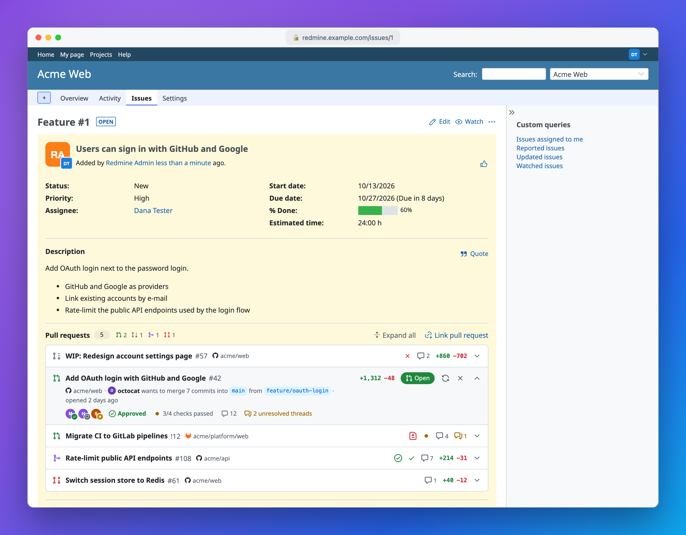
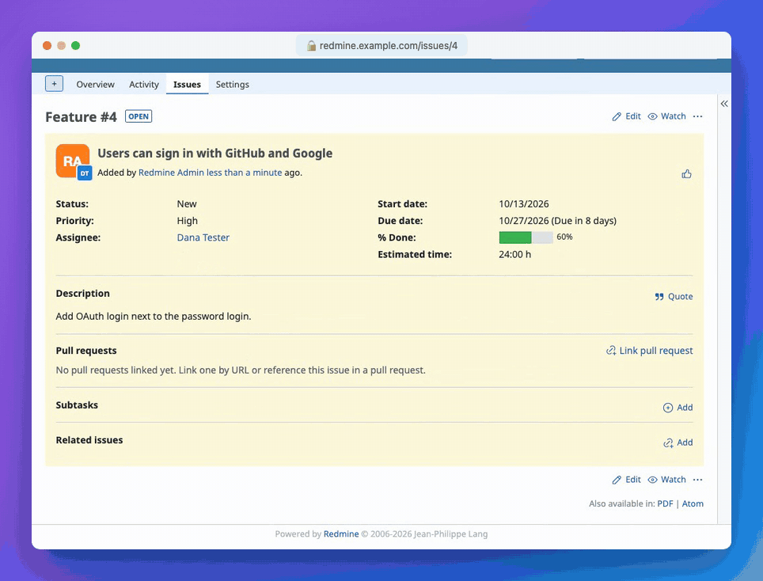
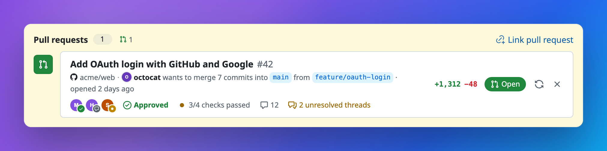
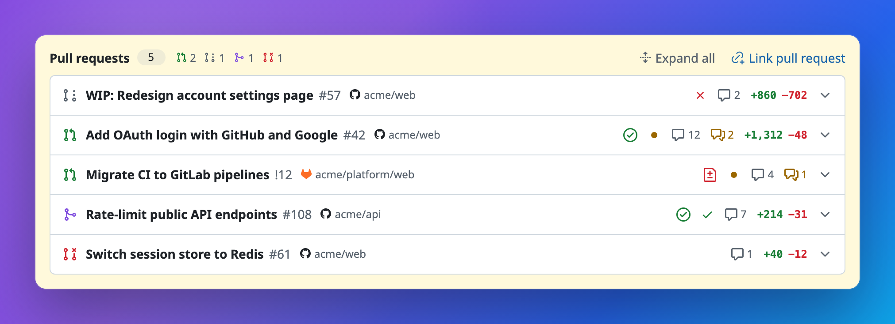

<p align="center">
  
</p>

<h1 align="center">Redmine Pull Requests</h1>

<p align="center">
  Vincula pull requests de GitHub y merge requests de GitLab a peticiones de <a href="https://www.redmine.org/">Redmine</a> y muestra su estado, revisiones y comprobaciones directamente en la página de la petición.
</p>

<p align="center">
  <a href="README.md">English</a> ·
  <a href="README.zh-CN.md">简体中文</a> ·
  <a href="README.ja.md">日本語</a> ·
  <b>Español</b>
</p>

<p align="center">
  <a href="https://github.com/aarondpn/redmine_pull_requests/actions/workflows/e2e.yml"></a>
  <a href="https://github.com/aarondpn/redmine_pull_requests/releases/latest"></a>
  <a href="https://www.ruby-lang.org/"></a>
  <a href="LICENSE"></a>
</p>

<p align="center">
  <a href="https://www.redmine.org/projects/redmine/wiki/changelog"></a>
</p>

<p align="center">
  <a href="#instalación">Instalación</a> ·
  <a href="#configuración">Configuración</a> ·
  <a href="#webhooks">Webhooks</a> ·
  <a href="API.md">API REST</a>
</p>



## Funcionalidades

- **GitHub y GitLab** a la vez, incluidos GitHub Enterprise, GitLab autogestionado y los subgrupos
- **Muchos a muchos**: varios pull requests por petición, y un mismo pull request en varias peticiones
- **Detalles en tiempo real**: estado, autor, ramas, estadísticas del diff, revisores y decisión de revisión, comprobaciones de CI o pipeline, comentarios e hilos sin resolver
- **Vinculación por URL** o automática mediante **webhooks** a partir de `#123` en el título, la descripción o el nombre de la rama
- **Palabras clave para la corrección**: al fusionar un pull request que dice `Fixes #123` se resuelve la petición, igual que con un commit
- **Repositorios permitidos por proyecto**, para que los vínculos solo lleguen a los proyectos que confían en un repositorio
- **[API REST](API.md)** (en inglés), permisos por perfil, traducido a 8 idiomas



<table>
  <tr>
    <td width="50%"></td>
    <td width="50%"></td>
  </tr>
</table>

## Instalación

Redmine 5.0 a 7.0 (probado en CI con 5.1, 6.1 y 7.0), Ruby 2.7 o posterior, sin gems adicionales.

Extraiga la [última versión](https://github.com/aarondpn/redmine_pull_requests/releases/latest) en el directorio `plugins` de Redmine (o clone allí el repositorio como `redmine_pull_requests`) y ejecute las migraciones:

```sh
cd /path/to/redmine
tar xzf redmine_pull_requests-vX.Y.Z.tar.gz -C plugins
# or: git clone https://github.com/aarondpn/redmine_pull_requests.git plugins/redmine_pull_requests
bundle exec rake redmine:plugins:migrate RAILS_ENV=production
bundle exec rake assets:precompile RAILS_ENV=production   # Redmine 6.0 and newer
```

El directorio del plugin debe llamarse `redmine_pull_requests` (los archivos de versión ya lo contienen). En Redmine 6.0+, si omite `assets:precompile`, el panel aparece sin estilos y sus filas no se pueden expandir. Reinicie Redmine y, a continuación:

1. Configure el plugin en *Administración » Extensiones » Pull Requests » Configurar*.
2. Conceda **Ver pull requests**, **Administrar pull requests** y **Administrar la configuración de pull requests** a sus perfiles en *Administración » Perfiles y permisos*.
3. Active el módulo **Pull requests** en un proyecto e indique sus [repositorios permitidos](#repositorios-permitidos). Hasta entonces no se puede vincular nada en él.

Los archivos de versión incluyen una [atestación de procedencia de compilación](https://docs.github.com/actions/security-for-github-actions/using-artifact-attestations): `gh attestation verify redmine_pull_requests-vX.Y.Z.tar.gz -R aarondpn/redmine_pull_requests`.

**Actualización**: sustituya el directorio del plugin (o ejecute `git pull`), ejecute `redmine:plugins:migrate` y (Redmine 6.0+) `assets:precompile` como se indica arriba, y reinicie. Consulte en el [registro de cambios](CHANGELOG.md) los pasos que requiera cada versión.

### Desinstalación

```sh
bundle exec rake redmine:plugins:migrate NAME=redmine_pull_requests VERSION=0 RAILS_ENV=production
rm -r plugins/redmine_pull_requests
```

Esto elimina las tablas del plugin. Reinicie Redmine después. Para eliminar también las entradas del módulo, la configuración y los assets publicados que Redmine conserva:

```sh
bundle exec rails runner -e production "EnabledModule.where(name: 'pull_requests').delete_all; Setting.where(name: 'plugin_redmine_pull_requests').delete_all"
rm -rf public/plugin_assets/redmine_pull_requests public/assets/plugin_assets/redmine_pull_requests
```

## Configuración

GitHub y GitLab tienen cada uno su propia sección en la configuración del plugin:

| Opción | Descripción |
| --- | --- |
| URL / URL de la API | GitHub: `https://github.com`, `https://api.github.com` (Enterprise: `https://github.example.com/api/v3`). GitLab: `https://gitlab.com`, `https://gitlab.com/api/v4`; en instancias autogestionadas también bajo una ruta. |
| Token de acceso | Necesario para repositorios privados y para actualizar revisiones y comprobaciones desde webhooks. Variable de entorno: `REDMINE_PR_GITHUB_TOKEN` / `REDMINE_PR_GITLAB_TOKEN`. |
| Secreto del webhook | Necesario para los webhooks. Variable de entorno: `REDMINE_PR_GITHUB_WEBHOOK_SECRET` / `REDMINE_PR_GITLAB_WEBHOOK_SECRET`. |

Los tokens y secretos guardados nunca se muestran y se filtran del log; deje un campo en blanco para conservar el valor o marque *Eliminar* para borrarlo. Con las variables de entorno no se guardan en la base de datos. Otras opciones: vincular referencias `#123` sin palabra clave (en caso contrario, solo `refs #123`, `fixes #123`), vincular por nombre de rama (`123-login`, `feature/123-login`, `issue-123`) y aplicar las palabras clave para la corrección de Redmine al fusionar.

### Tokens de acceso

El plugin solo lee de GitHub y GitLab.

- **GitHub, token clásico**: el ámbito `repo` para repositorios privados; para los públicos no hace falta ninguno.
- **GitHub, token fine-grained**: *Pull requests* y *Commit statuses*, de solo lectura. Estos tokens no pueden cargar las ejecuciones de comprobaciones (check runs, p. ej. de GitHub Actions) en repositorios privados; use un token clásico si las necesita.
- **GitLab**: token personal, de grupo o de proyecto con `read_api`.

Sin token, GitHub solo permite 60 solicitudes por hora. Los hilos sin resolver de GitHub siempre requieren un token (GraphQL). Los detalles que un token no puede cargar (revisiones, comprobaciones, hilos, número de commits en GitLab) se omiten y el error se escribe en el log, así que, si las comprobaciones no aparecen, revise primero el token.

### Repositorios permitidos

En *Proyecto » Configuración » Pull requests*, un patrón por línea, sin distinguir mayúsculas de minúsculas; las líneas que empiezan por `#` se ignoran:

- `acme/web`: este repositorio, en GitHub y en GitLab
- `acme/*`: todos los repositorios de `acme` (un nivel)
- `acme/**`: el grupo de GitLab `acme`, incluidos los subgrupos
- `github:acme/web`, `gitlab:acme/**`: un solo proveedor

Los webhooks, los vínculos manuales, las palabras clave para la corrección y la API solo llegan a peticiones de proyectos que permiten el repositorio, lo que protege frente a repositorios que no son de confianza, como los forks. Los subproyectos no heredan la lista.

> [!IMPORTANT]
> *Administrar pull requests* permite a un usuario cargar cualquier pull request de los repositorios permitidos con el token configurado, y *Administrar la configuración de pull requests* decide cuáles son esos repositorios. Limite el token a los repositorios que deban estar en Redmine. La lista de permitidos se basa en el secreto del webhook, uno por proveedor: quien lo conozca puede enviar eventos de cualquier repositorio, así que trátelo como una contraseña y añada el webhook solo a repositorios y organizaciones cuyos administradores sean de su confianza.

### Webhooks

| | GitHub | GitLab |
| --- | --- | --- |
| URL | `https://redmine.example.com/pull_requests/github/webhook` | `https://redmine.example.com/pull_requests/gitlab/webhook` |
| Content type | `application/json` | – |
| Secret | Secreto del webhook de GitHub | *Secret token*: secreto del webhook de GitLab |
| Eventos necesarios | *Pull requests* | *Merge request events* |
| Eventos opcionales, para mantener actualizadas las revisiones y las comprobaciones | *Pull request reviews*, *Pull request review comments*, *Pull request review threads*, *Issue comments*, *Check runs*, *Check suites*, *Statuses* | *Comments*, *Pipeline events* |

Añádalo a un repositorio u organización en GitHub, o a un proyecto o grupo (Premium y Ultimate) en GitLab, en *Settings » Webhooks*. Las peticiones se vinculan cuando un pull request se abre, se edita, se reabre o se marca como listo para revisión, también por la URL completa de la petición si coincide con el *Nombre y ruta del servidor* de *Administración » Configuración » General*. Los vínculos que se eliminan a mano no vuelven a añadirse. Las palabras clave para la corrección se aplican una sola vez al fusionar, y los cambios se registran como realizados por *Anónimo*.

Como los payloads no incluyen las revisiones ni las comprobaciones, el plugin las vuelve a cargar desde la API en una tarea en segundo plano (ActiveJob, que se ejecuta dentro del proceso de Redmine salvo que haya configurado otro adaptador de colas) cuando hay un token configurado; sin token, use *Actualizar*.

## Contribuir

Consulte [CONTRIBUTING.md](CONTRIBUTING.md) (en inglés) para saber cómo ejecutar las pruebas y publicar versiones, y [SECURITY.md](SECURITY.md) para saber cómo informar de vulnerabilidades.

## Licencia

[MIT](LICENSE). Los iconos son [GitHub Octicons](https://github.com/primer/octicons) (MIT) y el logotipo de GitLab procede de [Simple Icons](https://simpleicons.org) (CC0).
