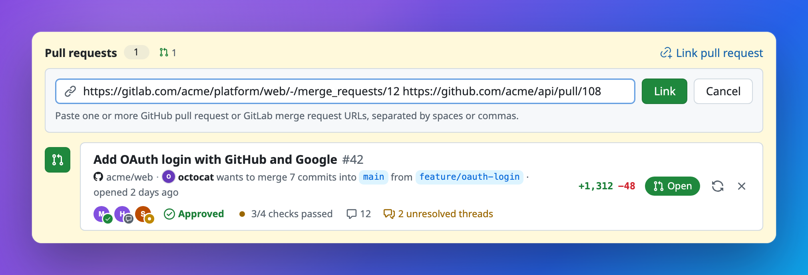
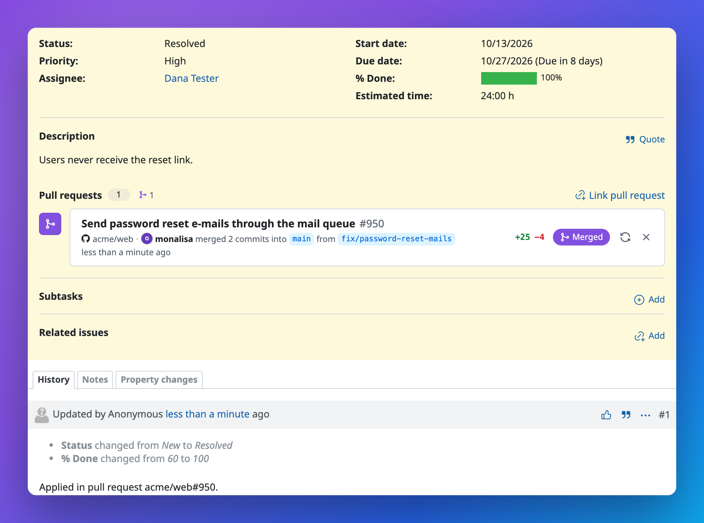

# Redmine Pull Requests

[English](README.md) | [简体中文](README.zh-CN.md) | **日本語** | [Español](README.es.md)

[](https://github.com/aarondpn/redmine_pull_requests/actions/workflows/e2e.yml)
[](LICENSE)


GitHub のプルリクエストと GitLab のマージリクエストを Redmine のチケットに関連付け、その状態・レビュー・チェックを GitHub 風の表示でチケット画面に直接表示します。


## 機能

- **1 つのチケットに複数のプルリクエスト**を関連付けられ、1 つのプルリクエストを複数のチケットに関連付けることもできます
- **GitHub と GitLab** を併用可能。GitHub Enterprise、セルフマネージドの GitLab、GitLab のサブグループにも対応
- **最新の状態**: オープン、ドラフト、マージ済み、クローズ済みを、作成者・ブランチ・コミット・差分の統計とともに表示
- **レビューの詳細**: レビュアーとそれぞれのレビュー状態、承認済み / 変更リクエストあり / レビューが必要、CI のチェックまたは GitLab のパイプライン、コメント、未解決のスレッド
- **コンパクトなリスト**: 複数のプルリクエストがあるチケットでは一覧表示になり、各行を展開すると詳細を確認できます
- **URL で関連付け**: プルリクエスト / マージリクエストの URL を 1 つ以上貼り付けるだけ
- **プロジェクトごとの許可リポジトリ**: Webhook や関連付けは、そのリポジトリを信頼するプロジェクトにだけ届きます
- **Webhook**: タイトル・説明・ブランチ名の `#123` から自動で関連付け、状態・レビュー・チェックをリアルタイムに更新
- **修正用キーワード**: `Fixes #123` と書かれたプルリクエストをマージすると、コミットと同じようにチケットが解決されます
- **REST API**: スクリプトや CI からプルリクエストの一覧取得・関連付け・更新・関連付け解除が可能
- ロールごとの権限設定、Redmine 5.0〜7.0 に対応
- 英語、ドイツ語、フランス語、スペイン語、日本語、簡体字中国語、ポーランド語、ロシア語に**翻訳済み**

### 実際の動作


<table>
  <tr>
    <td width="50%"></td>
    <td width="50%"></td>
  </tr>
  <tr>
    <td><b>すべてをひと目で</b><br>レビュアーとそのレビュー状態、レビュー結果、チェック、コメント、未解決のスレッドを表示します。</td>
    <td><b>数が増えてもコンパクトに</b><br>複数のプルリクエストは一覧にまとめて表示。GitHub と GitLab を並べて確認できます。</td>
  </tr>
  <tr>
    <td width="50%"></td>
    <td width="50%"></td>
  </tr>
  <tr>
    <td><b>URL で関連付け</b><br>プルリクエストやマージリクエストの URL を 1 つ以上貼り付けると、詳細が API から読み込まれます。</td>
    <td><b>マージで解決</b><br><code>Fixes #123</code> と書かれたプルリクエストがマージされると、Webhook 経由で関連付けられたチケットが解決されます。</td>
  </tr>
</table>

## 互換性

| Redmine | Rails | CI でのテスト対象 |
| --- | --- | --- |
| 7.0 | 8.1 | 7.0 |
| 6.0, 6.1 | 7.2 | 6.1 |
| 5.0, 5.1 | 6.1 | 5.1 |

すべての変更は、各メジャーバージョンの最新マイナーリリースに対して、バインドマウントしたチェックアウトとリリースアーカイブからのインストールの両方で E2E テストされています。追加の gem は不要です。Ruby 2.7 以降が必要ですが、これが関係するのは Ruby 2.5 と 2.6 も許容している Redmine 5.0 だけです。

## インストール

[最新リリース](https://github.com/aarondpn/redmine_pull_requests/releases/latest)から `redmine_pull_requests-vX.Y.Z.tar.gz` をダウンロードして Redmine の `plugins` ディレクトリに展開し(またはそこにリポジトリをクローンし)、マイグレーションを実行します。Redmine 6.0 以降では、アセットのプリコンパイルも行ってください。

```sh
cd /path/to/redmine
tar xzf redmine_pull_requests-vX.Y.Z.tar.gz -C plugins
# or: git clone https://github.com/aarondpn/redmine_pull_requests.git plugins/redmine_pull_requests
bundle exec rake redmine:plugins:migrate RAILS_ENV=production
bundle exec rake assets:precompile RAILS_ENV=production   # Redmine 6.0 and newer
```

プラグインのディレクトリ名は `redmine_pull_requests` でなければなりません(アーカイブには最初からこの名前で含まれています)。Redmine 6.0 以降は、アセットファイルが前回のビルドより新しい場合にしか自動で再ビルドしませんが、リリースアーカイブ内のファイルの日付はリリース日になっています。`assets:precompile` を実行しないとプラグインのスタイルシートとスクリプトが 404 になり、パネルにスタイルが適用されず、行も展開できません。

Redmine を再起動したら、次の手順を行います。

1. 「*管理 » プラグイン » Pull Requests » 設定*」でプラグインを設定します。
2. ロールに **プルリクエストの閲覧**、**プルリクエストの管理**、**プルリクエスト設定の管理** の権限を付与します(「*管理 » ロールと権限*」)。
3. プロジェクトの設定で **プルリクエスト** モジュールを有効にし、「*プロジェクト » 設定 » プルリクエスト*」でプロジェクトのリポジトリを登録します([許可するリポジトリ](#許可するリポジトリ)を参照)。登録するまで、そのプロジェクトでは何も関連付けられません。

リリースアーカイブには[ビルドの来歴証明(build provenance attestation)](https://docs.github.com/actions/security-for-github-actions/using-artifact-attestations)が付いています。ダウンロードしたファイルは `gh attestation verify redmine_pull_requests-vX.Y.Z.tar.gz -R aarondpn/redmine_pull_requests` で検証できます。

### アップグレード

プラグインのディレクトリを新しいバージョンに置き換え(または `git pull`)、`bundle exec rake redmine:plugins:migrate RAILS_ENV=production` を実行し、Redmine 6.0 以降では `bundle exec rake assets:precompile RAILS_ENV=production` も実行してから Redmine を再起動します。バージョンごとに必要な手順は[変更履歴](CHANGELOG.md)を確認してください。

### アンインストール

```sh
bundle exec rake redmine:plugins:migrate NAME=redmine_pull_requests VERSION=0 RAILS_ENV=production
rm -r plugins/redmine_pull_requests
```

これでプラグインのテーブルが削除されます。その後 Redmine を再起動してください。

害はありませんが、Redmine にはいくつかのデータが残ります。プロジェクトの *プルリクエスト* モジュールの登録、プラグインの設定、そして `public/plugin_assets/redmine_pull_requests`(Redmine 5)または `public/assets/plugin_assets/redmine_pull_requests`(Redmine 6.0 以降)に公開されたアセットです。これらも削除するには次のようにします。

```sh
bundle exec rails runner -e production "EnabledModule.where(name: 'pull_requests').delete_all; Setting.where(name: 'plugin_redmine_pull_requests').delete_all"
rm -rf public/plugin_assets/redmine_pull_requests public/assets/plugin_assets/redmine_pull_requests
```

## 設定

プラグインの設定画面には、GitHub と GitLab それぞれのセクションがあります。

| 設定 | 説明 |
| --- | --- |
| GitHub のURL / GitLab のURL、APIのURL | GitHub: `https://github.com`、`https://api.github.com`(Enterprise: `https://github.example.com/api/v3`)。GitLab: `https://gitlab.com`、`https://gitlab.com/api/v4`。セルフマネージドでは `https://example.com/gitlab` のようなパス配下も可。 |
| アクセストークン | [アクセストークン](#アクセストークン)を参照。プライベートリポジトリと、Webhook によるレビューとチェックの更新に必要です。`REDMINE_PR_GITHUB_TOKEN` / `REDMINE_PR_GITLAB_TOKEN` でも設定できます。 |
| Webhookシークレット | Webhook に必要です。`REDMINE_PR_GITHUB_WEBHOOK_SECRET` / `REDMINE_PR_GITLAB_WEBHOOK_SECRET` でも設定できます。 |

保存済みのトークンとシークレットは設定画面に表示されません。保存済みの値をそのまま使うにはフィールドを空欄のままにし、消去するには *削除* にチェックを入れます。これらは Rails のログから除外されます。`REDMINE_PR_*` 環境変数で設定すれば、データベースにも保存されません。

共通の関連付けオプション:

| 設定 | 説明 |
| --- | --- |
| キーワードのない `#123` 形式の参照も関連付ける | 無効の場合、Redmine のコミット用キーワード付きの参照(`refs #123`、`fixes #123`)のみが関連付けられます。 |
| ブランチ名で関連付ける | `123-login`、`feature/123-login`、`issue-123` のようなブランチを関連付けます。 |
| マージ時に修正用キーワードを適用する | 「*管理 » 設定 » リポジトリ*」の *修正用キーワード* を使用します。 |

### 許可するリポジトリ

各プロジェクトは、どのリポジトリをチケットに関連付けてよいかを「*プロジェクト » 設定 » プルリクエスト*」で決めます(*プルリクエスト設定の管理* 権限と、モジュールの有効化が必要です)。1 行に 1 パターンで、大文字と小文字は区別されません。

- `acme/web`: GitHub と GitLab 上のこのリポジトリ
- `acme/*`: `acme` のすべてのリポジトリ(1 階層のみ)
- `acme/**`: GitLab グループ `acme` のすべてのプロジェクト(サブグループを含む)
- `github:acme/web` または `gitlab:acme/**`: 一方のプロバイダーだけに適用するパターン

空行と `#` で始まる行は無視されます。Webhook がチケットを関連付けたり修正用キーワードを適用したりするのは、そのプルリクエストのリポジトリを許可しているプロジェクトのチケットだけです。他のプロジェクトのチケットへの参照は無視されます。手動での関連付けと REST API も、許可されたリポジトリしか受け付けません。プロジェクトのリストが空の間は、そのプロジェクトでは何も関連付けられません。ただし、すでに関連付けられているプルリクエストは引き続き表示されます。サブプロジェクトはリストを継承しません。

プロジェクトで *プルリクエストの管理* 権限を持つユーザーは、設定済みのアクセストークンを使って、そのプロジェクトで許可されたリポジトリのどのプルリクエストでも読み込めます。また *プルリクエスト設定の管理* 権限を持つユーザーは、許可するリポジトリを変更できます。この権限は他のプロジェクト設定の権限と同様に慎重に付与し、トークンは Redmine で扱うべきリポジトリだけにアクセスできるよう制限してください。

許可リストは、プロジェクトが信頼していないリポジトリ(たとえば公開リポジトリのフォーク)からのプルリクエストを防ぎます。ただしこれは Webhook シークレットが前提です。シークレットはプロバイダーごとに 1 つで、それを知っている人は任意のリポジトリの名前でイベントを送信できます。シークレットはパスワードと同様に扱い、管理者を信頼できるリポジトリや Organization にだけ Webhook を追加してください。

### アクセストークン

このプラグインは GitHub と GitLab からデータを読み取るだけです。

- **GitHub の Fine-grained トークン**: リポジトリ権限 *Pull requests* と *Commit statuses* をどちらも読み取り専用で付与します(*Metadata* の読み取り専用は自動で追加されます)。GitHub は Fine-grained トークンに *Checks* 権限を提供していないため、このトークンではプライベートリポジトリのチェック実行(GitHub Actions など)を読み込めません。必要な場合はクラシックトークンを使ってください。
- **GitHub のクラシックトークン**: プライベートリポジトリには `repo` スコープが必要です(チェック実行も含む)。公開リポジトリにはスコープは不要です。
- **GitLab**: `read_api` スコープを持つパーソナル、グループ、またはプロジェクトアクセストークン。

公開リポジトリはトークンなしでも使えますが、その場合 GitHub では 1 時間あたり 60 リクエストまでに制限されます。トークンに必要な権限がない場合、プラグインは読み込めない詳細(レビュー、チェック、未解決のスレッド、GitLab のコミット数)を表示せず、エラーを Redmine のログに記録するだけです。チェックが表示されないときは、まずトークンの権限を確認してください。

### GitHub の Webhook

リポジトリまたは Organization の設定で Webhook を追加します。

- **Payload URL**: `https://redmine.example.com/pull_requests/github/webhook`
- **Content type**: `application/json`
- **Secret**: プラグイン設定の GitHub 用 Webhook シークレット
- **Events**: *Pull requests*。レビューとチェックを最新に保つには、さらに *Pull request reviews*、*Pull request review comments*、*Pull request review threads*、*Issue comments*、*Check runs*、*Check suites*、*Statuses*

### GitLab の Webhook

プロジェクトの設定、または GitLab Premium と Ultimate ではグループの設定(*設定 » Webhook*)で Webhook を追加します。

- **URL**: `https://redmine.example.com/pull_requests/gitlab/webhook`
- **シークレットトークン**: プラグイン設定の GitLab 用 Webhook シークレット
- **トリガー**: *マージリクエストイベント*。ディスカッションとパイプラインを最新に保つには、さらに *コメント* と *パイプラインイベント*

Webhook のペイロードには、レビュー、チェック、(GitLab では)作成者とコミット数が含まれません。アクセストークンが設定されていれば、プラグインはこれらをバックグラウンドジョブ(Rails の ActiveJob。別のキューアダプターを設定していない限り Redmine のプロセス内で実行されます)で API から再読み込みするため、Webhook の配信にはすぐに応答します。ジョブは数秒後に開始され、それまでに届いた同じプルリクエストの配信は、その 1 回の再読み込みでまとめて処理されます。トークンがない場合は、更新ボタン(*GitHub から更新* / *GitLab から更新*)をクリックしたときにだけ更新されます。GitHub の未解決のレビュースレッドは GraphQL API から取得するため、トークンが必要です。

### 関連付け

Webhook は、関連付けられたプルリクエスト / マージリクエストを常に最新の状態に保ちます。参照されたチケットは、プルリクエストが作成、編集、再オープン、またはレビュー可能(ready for review)にされたときに関連付けられます。ただし、チケットのプロジェクトでモジュールが有効になっていて、[そのリポジトリが許可されている](#許可するリポジトリ)必要があります。GitLab では、編集によってチケットが関連付けられるのはタイトル、説明、ドラフト状態が変わった場合だけで、プッシュ、ラベル、担当者、レビュアーの変更では関連付けられません。1 つのイベントで処理される参照は最大 50 件です。手動で解除した関連付けは、その後のプッシュで再び追加されることはありません。`release/2024-10`、`v2.3.1`、`2024-q3` のようなブランチ名ではチケットは関連付けられません。チケットはフル URL(例: `https://redmine.example.com/issues/123`)でも認識されます。ただし「*管理 » 設定 » 全般*」の *ホスト名とパス* と一致している必要があります。

修正用キーワードは、マージイベントを受け取ったときにプルリクエストごとに 1 回だけ適用されます。修正用キーワードによるステータスの変更は *匿名ユーザー* による変更として記録されます。これは、Redmine 自身のコミット処理がユーザーに対応付けられないコミッターを扱う場合と同じです。

## REST API

「*管理 » 設定 » API*」(Redmine 7.0 では「*管理 » 設定 » 連携*」)で *RESTによるWebサービスを有効にする* をオンにする必要があります。認証とステータスコードは Redmine の他の API と同じです(`X-Redmine-API-Key` ヘッダー、`.json` または `.xml`)。読み取りには *プルリクエストの閲覧* 権限、それ以外のすべてのエンドポイントには *プルリクエストの管理* 権限が必要です。

| メソッド | パス | |
| --- | --- | --- |
| `GET` | `/issues/:issue_id/pull_requests.json` | チケットに関連付けられたプルリクエスト |
| `GET` | `/issues/:issue_id/pull_requests/:id.json` | 1 件のプルリクエスト |
| `POST` | `/issues/:issue_id/pull_requests.json` | URL でプルリクエスト / マージリクエストを関連付け。`201` と関連付けたプルリクエストを返します |
| `POST` | `/issues/:issue_id/pull_requests/:id/refresh.json` | GitHub/GitLab から再読み込み |
| `DELETE` | `/issues/:issue_id/pull_requests/:id.json` | 関連付けを解除。`204` を返します |

```sh
curl -X POST https://redmine.example.com/issues/123/pull_requests.json \
  -H "X-Redmine-API-Key: $REDMINE_API_KEY" -H "Content-Type: application/json" \
  -d '{"pull_request": {"urls": ["https://github.com/acme/web/pull/42",
                                 "https://gitlab.com/acme/platform/web/-/merge_requests/7"]}}'
```

`{"pull_request": {"url": "..."}}` で 1 つの URL を関連付けます。1 回のリクエストで指定できる URL は最大 20 件です。関連付けは冪等です。URL のいずれかが無効、[プロジェクトで許可されていない](#許可するリポジトリ)、または読み込めない場合は何も保存されず、理由を含む `422` が返されます。メッセージは API ユーザーの言語設定に従います(以下は日本語の場合)。

```json
{"errors": ["acme/secret はこのプロジェクトで許可されていません(プロジェクトの設定 › プルリクエスト)。", "GitHub から acme/web#9999 を読み込めませんでした(404 Not Found)。"]}
```

プルリクエストは次のような形式です(一部省略)。

```json
{
  "id": 1, "provider": "github", "repository": "acme/web", "number": 42, "reference": "acme/web#42",
  "url": "https://github.com/acme/web/pull/42", "title": "Add OAuth login with GitHub and Google",
  "state": "open", "status": "open", "draft": false,
  "author": {"login": "octocat", "avatar_url": "https://avatars.githubusercontent.com/u/583231"},
  "head_ref": "feature/oauth-login", "base_ref": "main", "head_sha": "6dcb09b5",
  "commits_count": 7, "additions": 1312, "deletions": 48, "changed_files": 23,
  "review_decision": "approved",
  "reviewers": [{"login": "monalisa", "state": "approved", "avatar_url": "..."}],
  "comments_count": 12, "unresolved_threads_count": 2,
  "checks": {"state": "pending", "total": 4, "passed": 3, "failed": 0, "url": "https://github.com/acme/web/pull/42/checks"},
  "opened_on": "2026-10-17T18:30:54Z", "synced_on": "2026-10-19T18:36:19Z",
  "linked_on": "2026-10-19T18:36:19Z", "linked_by": {"id": 5, "name": "Dana Tester"}, "link_source": "manual"
}
```

不明な値は `null` になります。ただし `author`、`merged_by`、`checks`、`linked_by` は、不明な場合は省略されます。`merged_by` はマージ済みのプルリクエストにのみ、`checks` はチェックまたはパイプラインが存在する場合にのみ、`linked_by` はユーザーによる関連付け(Webhook によるものではない)の場合にのみ含まれます。`merged_on` と `closed_on` は常に含まれ、プルリクエストがオープンの間は `null` です。

- `state`: `open`、`merged`、`closed` のいずれか。`status` ではさらに `draft` も区別されます。
- `review_decision`: `approved`、`changes_requested`、`review_required`、`null` のいずれか。
- レビュアーの `state`: `approved`、`changes_requested`、`commented`、`pending` のいずれか。
- `checks.state`: `success`、`failure`、`pending`、`neutral` のいずれか。GitLab ではパイプラインのステータスで、`total`、`passed`、`failed` は `null` です。
- `link_source`: `manual`(UI/API)または `webhook`。

## 開発

E2E テストは Docker で Redmine と GitHub/GitLab のモック API を起動し、[Playwright](https://playwright.dev) で実行します。

```sh
cd e2e
npm install
npx playwright install chromium
npm test                            # starts Redmine 7.0, seeds it and runs all tests
REDMINE_IMAGE=redmine:5.1 npm test  # any other Redmine image
npm run screenshots                 # regenerates the images in docs/
npm run stack:down                  # removes the containers
./install-test.sh 6.1               # installs a release archive of HEAD into a fresh redmine:6.1
```

`E2E_SKIP_STACK=1` を設定すると、起動済みでデータ投入済みのスタックを再利用します。

テスト中、Redmine は http://localhost:3000 で動作します(`admin` / `admin12345`、または `manager`、`dev`、`reporter` / `password123` でログイン)。別のポートを使うには、`REDMINE_PORT` と `MOCK_API_PORT` を `REDMINE_URL` と `MOCK_API_URL` と合わせて設定してください。

## リリース

1. `init.rb` の `version` を更新し、`CHANGELOG.md` にそのバージョンのセクションを追加します。
2. コミットしてからタグを付けてプッシュします: `git tag v1.2.3 && git push origin v1.2.3`

リリースワークフローは、タグが付いたコミットで E2E テストを実行し、タグが `init.rb` と一致することを確認してアーカイブをビルドし、変更履歴のセクションをリリースノートとして GitHub リリースを公開します。`v1.3.0-rc.1` のようなサフィックス付きのタグはプレリリースとして公開され、最新リリース(latest)にはなりません。

## セキュリティ

脆弱性の報告方法については [SECURITY.md](SECURITY.md) を参照してください。

## ライセンス

[MIT](LICENSE)

## クレジット

アイコンは [GitHub Octicons](https://github.com/primer/octicons)(MIT)、GitLab のロゴは [Simple Icons](https://simpleicons.org)(CC0)のものを使用しています。
