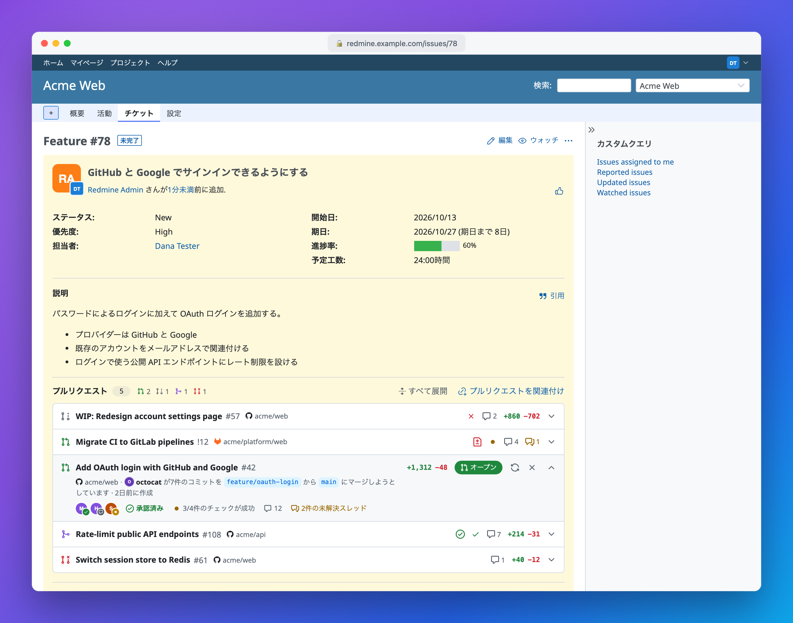
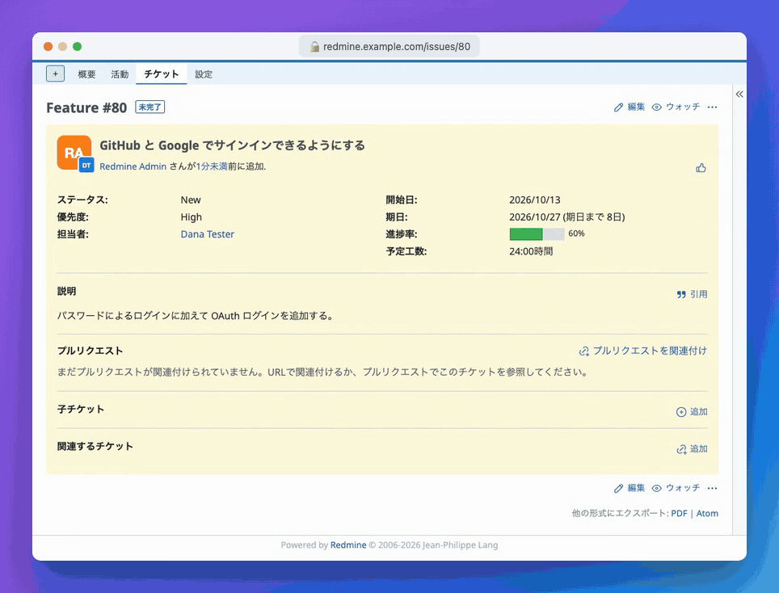
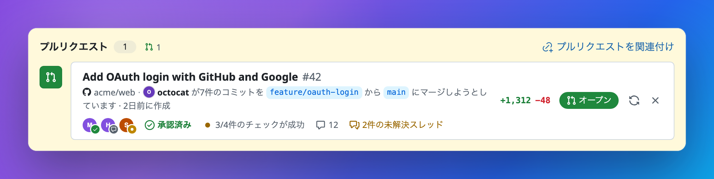
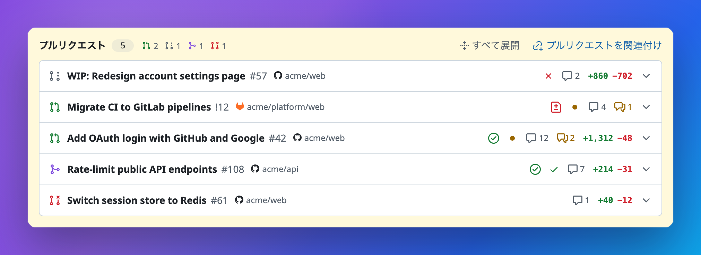

<p align="center">
  
</p>

<h1 align="center">Redmine Pull Requests</h1>

<p align="center">
  GitHub のプルリクエストと GitLab のマージリクエストを <a href="https://www.redmine.org/">Redmine</a> のチケットに関連付け、その状態・レビュー・チェックをチケット画面で直接確認できます。
</p>

<p align="center">
  <a href="README.md">English</a> ·
  <a href="README.zh-CN.md">简体中文</a> ·
  <b>日本語</b> ·
  <a href="README.es.md">Español</a>
</p>

<p align="center">
  <a href="https://github.com/aarondpn/redmine_pull_requests/actions/workflows/e2e.yml"></a>
  <a href="https://github.com/aarondpn/redmine_pull_requests/releases/latest"></a>
  <a href="https://www.ruby-lang.org/"></a>
  <a href="LICENSE"></a>
</p>

<p align="center">
  <a href="https://www.redmine.org/projects/redmine/wiki/changelog"></a>
</p>

<p align="center">
  <a href="#インストール">インストール</a> ·
  <a href="#設定">設定</a> ·
  <a href="#webhook">Webhook</a> ·
  <a href="API.md">REST API</a>
</p>



## 機能

- **GitHub と GitLab** を併用可能。GitHub Enterprise、セルフマネージドの GitLab、サブグループにも対応
- **多対多**: 1 つのチケットに複数のプルリクエストを、1 つのプルリクエストを複数のチケットに関連付け可能
- **最新の詳細**: 状態、作成者、ブランチ、差分の統計、レビュアーとレビュー結果、CI のチェックまたはパイプライン、コメント、未解決のスレッド
- **URL で関連付け**、または **Webhook** によりタイトル・説明・ブランチ名の `#123` から自動で関連付け
- **修正用キーワード**: `Fixes #123` と書かれたプルリクエストをマージすると、コミットと同じようにチケットが解決されます
- **プロジェクトごとの許可リポジトリ**: 関連付けは、そのリポジトリを信頼するプロジェクトにだけ届きます
- **[REST API](API.md)**(英語)、ロールごとの権限設定、8 言語に翻訳済み



<table>
  <tr>
    <td width="50%"></td>
    <td width="50%"></td>
  </tr>
</table>

## インストール

Redmine 5.0〜7.0(CI では 5.1、6.1、7.0 でテスト)、Ruby 2.7 以降が必要です。追加の gem は不要です。

[最新リリース](https://github.com/aarondpn/redmine_pull_requests/releases/latest)を Redmine の `plugins` ディレクトリに展開し(またはそこに `redmine_pull_requests` としてクローンし)、マイグレーションを実行します。

```sh
cd /path/to/redmine
tar xzf redmine_pull_requests-vX.Y.Z.tar.gz -C plugins
# or: git clone https://github.com/aarondpn/redmine_pull_requests.git plugins/redmine_pull_requests
bundle exec rake redmine:plugins:migrate RAILS_ENV=production
bundle exec rake assets:precompile RAILS_ENV=production   # Redmine 6.0 and newer
```

プラグインのディレクトリ名は `redmine_pull_requests` でなければなりません(リリースアーカイブには最初からこの名前で含まれています)。Redmine 6.0 以降で `assets:precompile` を実行しないと、パネルにスタイルが適用されず、行も展開できません。Redmine を再起動したら、次の手順を行います。

1. 「*管理 » プラグイン » Pull Requests » 設定*」でプラグインを設定します。
2. 「*管理 » ロールと権限*」で、ロールに **プルリクエストの閲覧**、**プルリクエストの管理**、**プルリクエスト設定の管理** の権限を付与します。
3. プロジェクトで **プルリクエスト** モジュールを有効にし、[許可するリポジトリ](#許可するリポジトリ)を登録します。登録するまで、そのプロジェクトでは何も関連付けられません。

リリースアーカイブには[ビルドの来歴証明(build provenance attestation)](https://docs.github.com/actions/security-for-github-actions/using-artifact-attestations)が付いています。検証: `gh attestation verify redmine_pull_requests-vX.Y.Z.tar.gz -R aarondpn/redmine_pull_requests`

**アップグレード**: プラグインのディレクトリを置き換え(または `git pull`)、上記と同様に `redmine:plugins:migrate` と(Redmine 6.0 以降では)`assets:precompile` を実行してから再起動します。バージョンごとに必要な手順は[変更履歴](CHANGELOG.md)を確認してください。

### アンインストール

```sh
bundle exec rake redmine:plugins:migrate NAME=redmine_pull_requests VERSION=0 RAILS_ENV=production
rm -r plugins/redmine_pull_requests
```

これでプラグインのテーブルが削除されます。その後 Redmine を再起動してください。Redmine に残るモジュールの登録、プラグインの設定、公開されたアセットも削除するには、次のようにします。

```sh
bundle exec rails runner -e production "EnabledModule.where(name: 'pull_requests').delete_all; Setting.where(name: 'plugin_redmine_pull_requests').delete_all"
rm -rf public/plugin_assets/redmine_pull_requests public/assets/plugin_assets/redmine_pull_requests
```

## 設定

プラグインの設定画面には、GitHub と GitLab それぞれのセクションがあります。

| 設定 | 説明 |
| --- | --- |
| URL / APIのURL | GitHub: `https://github.com`、`https://api.github.com`(Enterprise: `https://github.example.com/api/v3`)。GitLab: `https://gitlab.com`、`https://gitlab.com/api/v4`。セルフマネージドではパス配下も可。 |
| アクセストークン | プライベートリポジトリと、Webhook によるレビューとチェックの更新に必要です。環境変数: `REDMINE_PR_GITHUB_TOKEN` / `REDMINE_PR_GITLAB_TOKEN` |
| Webhookシークレット | Webhook に必要です。環境変数: `REDMINE_PR_GITHUB_WEBHOOK_SECRET` / `REDMINE_PR_GITLAB_WEBHOOK_SECRET` |

保存済みのトークンとシークレットは表示されず、ログからも除外されます。保存済みの値をそのまま使うにはフィールドを空欄のままにし、消去するには *削除* にチェックを入れます。環境変数で設定すれば、データベースにも保存されません。その他のオプション: キーワードのない `#123` 形式の参照の関連付け(無効の場合は `refs #123`、`fixes #123` のみ)、ブランチ名による関連付け(`123-login`、`feature/123-login`、`issue-123`)、マージ時の Redmine の修正用キーワードの適用。

### アクセストークン

このプラグインは GitHub と GitLab からデータを読み取るだけです。

- **GitHub のクラシックトークン**: プライベートリポジトリには `repo` スコープが必要です。公開リポジトリにはスコープは不要です。
- **GitHub の Fine-grained トークン**: *Pull requests* と *Commit statuses* を読み取り専用で付与します。このトークンではプライベートリポジトリのチェック実行(GitHub Actions など)を読み込めません。必要な場合はクラシックトークンを使ってください。
- **GitLab**: `read_api` スコープを持つパーソナル、グループ、またはプロジェクトアクセストークン。

トークンなしでは、GitHub では 1 時間あたり 60 リクエストまでに制限されます。GitHub の未解決のスレッドには常にトークンが必要です(GraphQL)。トークンで読み込めない詳細(レビュー、チェック、スレッド、GitLab のコミット数)は表示されず、エラーがログに記録されます。チェックが表示されないときは、まずトークンを確認してください。

### 許可するリポジトリ

「*プロジェクト » 設定 » プルリクエスト*」で、1 行に 1 パターンを指定します。大文字と小文字は区別されず、`#` で始まる行は無視されます。

- `acme/web`: GitHub と GitLab 上のこのリポジトリ
- `acme/*`: `acme` のすべてのリポジトリ(1 階層のみ)
- `acme/**`: GitLab グループ `acme`(サブグループを含む)
- `github:acme/web`、`gitlab:acme/**`: 一方のプロバイダーのみ

Webhook、手動での関連付け、修正用キーワード、API が届くのは、そのリポジトリを許可しているプロジェクトのチケットだけです。これにより、フォークのような信頼できないリポジトリから保護されます。サブプロジェクトはリストを継承しません。

> [!IMPORTANT]
> *プルリクエストの管理* 権限を持つユーザーは、設定済みのトークンを使って、許可されたリポジトリのどのプルリクエストでも読み込めます。そして、それがどのリポジトリかは *プルリクエスト設定の管理* 権限で決まります。トークンは Redmine で扱うべきリポジトリだけにアクセスできるよう制限してください。許可リストは Webhook シークレット(プロバイダーごとに 1 つ)が前提です。シークレットを知っている人は任意のリポジトリのイベントを送信できるため、パスワードと同様に扱い、管理者を信頼できるリポジトリや Organization にだけ Webhook を追加してください。

### Webhook

| | GitHub | GitLab |
| --- | --- | --- |
| URL | `https://redmine.example.com/pull_requests/github/webhook` | `https://redmine.example.com/pull_requests/gitlab/webhook` |
| Content type | `application/json` | – |
| シークレット | GitHub 用 Webhook シークレット | *Secret token*: GitLab 用 Webhook シークレット |
| 必須のイベント | *Pull requests* | *Merge request events* |
| 任意のイベント(レビューとチェックを最新に保つため) | *Pull request reviews*、*Pull request review comments*、*Pull request review threads*、*Issue comments*、*Check runs*、*Check suites*、*Statuses* | *Comments*、*Pipeline events* |

GitHub ではリポジトリまたは Organization、GitLab ではプロジェクトまたは(Premium と Ultimate では)グループの *Settings » Webhooks* で追加します。チケットは、プルリクエストが作成、編集、再オープン、またはレビュー可能(ready for review)にされたときに関連付けられます。「*管理 » 設定 » 全般*」の *ホスト名とパス* と一致していれば、チケットのフル URL でも関連付けられます。手動で解除した関連付けは再び追加されません。修正用キーワードはマージ時に 1 回だけ適用され、*匿名ユーザー* による変更として記録されます。

ペイロードにはレビューとチェックが含まれないため、トークンが設定されていれば、プラグインはこれらをバックグラウンドジョブ(ActiveJob。別のキューアダプターを設定していない限り Redmine のプロセス内で実行されます)で API から再読み込みします。トークンがない場合は *GitHub から更新* / *GitLab から更新* を使ってください。

## コントリビューション

テストの実行とリリースについては [CONTRIBUTING.md](CONTRIBUTING.md)(英語)を、脆弱性の報告については [SECURITY.md](SECURITY.md) を参照してください。

## ライセンス

[MIT](LICENSE)。アイコンは [GitHub Octicons](https://github.com/primer/octicons)(MIT)、GitLab のロゴは [Simple Icons](https://simpleicons.org)(CC0)のものを使用しています。
